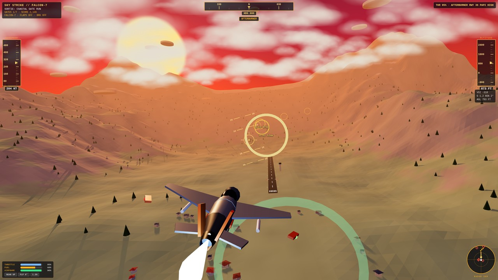

# Sky Strike — 3D Fighter Jet Simulator

Fly the **Falcon-7** fighter jet over the Coastal Range at golden hour:
thread gold gates, land soft on RWY 36, lock warships and mountain radar
towers in the diamond and send them down with a missile, beat the storm
front, climb above the clouds on afterburner, and hunt by night.

## Play

Open `game/index.html` in a desktop browser (or `node serve.ts`, then
http://localhost:8080). Keyboard + mouse, no install, no network.

| Key | Action |
|---|---|
| W / S | pitch down / up (mouse drag also steers) |
| A / D | bank left / right |
| SHIFT / CTRL | throttle up / down (past 92% = afterburner) |
| F · G | flaps · landing gear |
| C | chase / cockpit camera |
| SPACE | fire missile at the locked target |
| P · H · M | pause · help · mute |

## The 6 sorties

1. **Coastal Gate Run** — 7 gold gates from the sea to the peaks.
2. **Coastal Landing** — final approach RWY 36 over the bay, graded on sink rate + centreline.
3. **Sea Strike** — lock and sink both warships off the coast.
4. **Storm Strike** — sink the picket ship before the front closes (ETA 2:31), through rain, gusts and lightning.
5. **Above the Clouds** — climb through the deck, run the high gates in the sun, afterburner lit.
6. **Night Ridge Strike** — night run on the mountain radar towers.

Fuel burns with throttle (twice as fast in afterburner), over 6.0 G damages
the airframe, every kill is +1000, and every landing is graded S/A/B/C with
sink rate, centreline, fuel, hull and flight time on the debrief.

## Strike loop

Put a target inside the nose diamond and hold it: the lock builds, the
diamond goes solid red, the HUD flashes SHOOT and the cockpit target strip
shows LOCK SOLID with the range. Press SPACE — the missile leaves the wing
rail on a smoke trail, steers itself in, and the target detonates (flash +
fireball + smoke). Ships list and sink; radar towers burn and topple.
